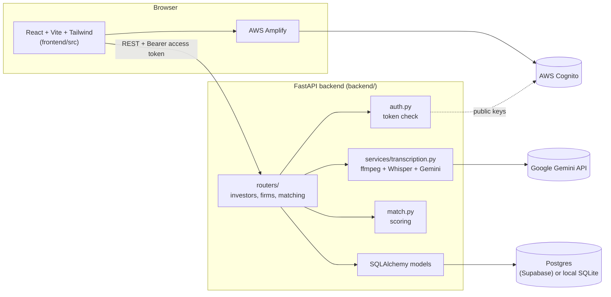

# Architecture

## What each piece does

| Piece | Where | Responsibility |
| --- | --- | --- |
| Pages and components | `frontend/src/pages`, `components` | Role-specific home pages, the investor form, the pitch recorder, the match tables |
| Route guards | `frontend/src/routers` | Send users to the page for their Cognito group ([auth](auth.md)) |
| API client | `frontend/src/services/api-client.ts` | Adds the Cognito access token to every request; can abort in-flight requests |
| Endpoints | `backend/app/routers` | HTTP layer only; each uses `get_current_user` |
| Token check | `backend/app/auth.py` | Verifies the Cognito token and returns the user's id |
| Transcription service | `backend/app/services/transcription.py` | Audio to WAV (ffmpeg), speech to text (faster-whisper, runs locally), profile fields (Gemini) |
| Matching | `backend/app/match.py` | Rule-based score ([matching](matching.md)) |
| Models and migrations | `backend/app/models`, `backend/alembic` | `Investors` and `Firms` tables, keyed by Cognito `sub` |
| Config | `backend/app/config.py`, `frontend/.env` | Every setting, read from the environment |

## Main flows

**Investor onboarding.** After sign-in the page asks `GET /investor/exists`. If there is no profile, the user fills the form;
the browser posts JSON to `POST /investor/create-profile`; the row is stored under the token's `sub`. With a profile,
the page shows the matches.

**Firm onboarding.** After sign-in the page asks `GET /firm/exists`. If there is no profile, the firm records a pitch
(up to 4 minutes) in the browser. The WebM goes to `POST /firm/create-profile` as multipart form data. The backend
converts it to 16 kHz mono WAV, transcribes it with Whisper, asks Gemini for a JSON profile (`null` for anything not
said), normalises the values (enums, numbers, booleans) and stores the firm. If Gemini fails or finds no firm name, nothing is
stored and the request fails with a 500, because the name is required.

**Matches.** `GET /firms/{id}/matching-investors` and `GET /investors/{id}/matching-firms` score the caller against the
other side and return the top 5.

## Where it runs

- Local: `uvicorn` and `npm run dev`, or `docker compose up --build` (the backend container applies migrations first).
- The Whisper model loads on first use and the Gemini key is read on first use, so the API starts without either.
- CI (`.github/workflows/ci.yml`) runs the backend tests and the frontend tests and build.

## API reference

Start the backend and open **http://localhost:8000/docs** (Swagger UI) or `/redoc`. Requests need a Cognito access
token in `Authorization: Bearer <token>`.

| Method and path | Purpose |
| --- | --- |
| `GET /investor/exists`, `GET /firm/exists` | Does the signed-in user have a profile? |
| `POST /investor/create-profile` | Create the investor profile (JSON body) |
| `POST /firm/create-profile` | Create the firm profile from an audio/video pitch (multipart: `file`, optional `email`) |
| `GET /firms/{firm_id}/matching-investors` | Top 5 investors for the signed-in firm |
| `GET /investors/{investor_id}/matching-firms` | Top 5 firms for the signed-in investor |
