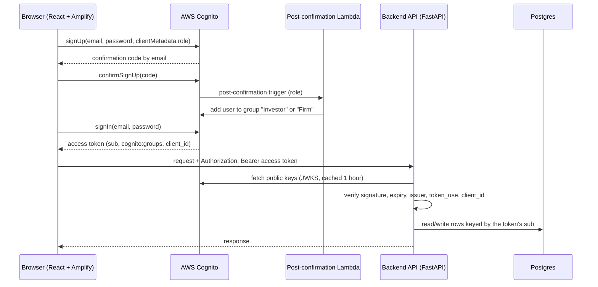

# Authentication and roles

Sign-in is **AWS Cognito**, used from the frontend through AWS Amplify. The backend never sees a password; it only
verifies the token Cognito issued.

## Roles

- Users pick a role when they sign up (`SignUpInvestor` or `SignUpFirm` in `frontend/src/components/Auth/`). The
  role is sent to Cognito as `clientMetadata.role`.
- A **post-confirmation Lambda trigger** on the user pool puts the user in the Cognito group `Investor` or `Firm`.
  That Lambda is **not in this repository**. What it does is inferred from the comments in `SignUpInvestor.tsx` and
  from how the frontend reads the groups, and I have not seen its code.
- The frontend's route guards (`frontend/src/routers/`) read `cognito:groups` from the access token:
  `PublicRoute` sends signed-in users to their home page, `InvestorRoute` and `FirmRoute` send everyone else away.
- Both account types use the same sign-in page; the group decides where they land.

## How the backend checks a token

[`backend/app/auth.py`](../backend/app/auth.py) (`get_current_user`) accepts only an access token that:

1. is signed (RS256) by a key in the pool's JWKS (fetched from Cognito, cached for an hour, refreshed once when a key
   id is unknown);
2. has not expired and was issued by this pool (`iss`);
3. has `token_use == "access"` (ID tokens are refused);
4. was issued to this app client (`client_id`).

It returns the token's `sub` (the user's UUID), which is the primary key of the `Investors` and `Firms` tables
(`cognito_sub`). `backend/tests/test_auth.py` covers forged, unsigned, expired, wrong-issuer, wrong-client and
ID tokens.

**Ownership:** the matching endpoints answer 403 unless the id in the URL equals the caller's own `sub`.

## Known limitations

- **The backend does not check the role.** Any valid token from the pool can call both investor and firm endpoints;
  only the frontend routes by group. A signed-in firm could call `POST /investor/create-profile`.
- **A real sign-in has not been verified against this code yet.** The tests use generated keys. Before relying on it,
  sign in against the real pool and confirm `/investor/exists` or `/firm/exists` returns 200.

## Settings

| Setting | Where | Notes |
| --- | --- | --- |
| `VITE_COGNITO_USER_POOL_ID`, `VITE_COGNITO_CLIENT_ID` | `frontend/.env` | Public identifiers |
| `COGNITO_REGION`, `COGNITO_USER_POOL_ID`, `COGNITO_CLIENT_ID` | `backend/.env` | Must match the frontend values |

## Using your own Cognito pool

Changing the four IDs is not enough. A new pool needs:

1. a user pool with email as the username and email verification;
2. an app client **without a client secret** (the browser app cannot keep one);
3. the groups `Investor` and `Firm`;
4. a post-confirmation Lambda trigger that reads `clientMetadata.role`, accepts only `Investor` or `Firm`, and adds the
   user to that group.

Profiles are keyed by the pool's user ids, so a new pool starts with no profiles; use a new database with it.
